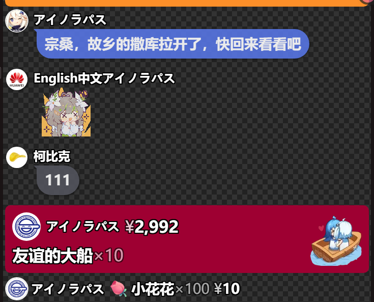

# LAPLACE 简约气泡样式

为 [LAPLACE Chat 弹幕机](https://laplace.live/chat)制作的「岁己同款」气泡样式，包含头像、昵称、弹幕气泡，以及礼物、醒目留言和上舰事件的样式。



## CSS 直链

**复制下面的 CSS 链接，填到 LAPLACE Chat 的「远程模版」中使用。**

Vercel 备用：

```text
https://laplace-simple-css.vercel.app/danmaku.css
```

[在线预览](https://laplace-simple-css.vercel.app/)仅用于查看、测试效果。远程模版需要的是以 `.css` 结尾的文件地址，不是预览页地址，也不是 GitHub 文件页面地址。

## 如何使用

1. 打开 [LAPLACE Chat 配置器](https://chat.laplace.live/)，填写你自己的哔哩哔哩直播间房间号。
2. 在模版设置中选择「远程模版」，粘贴上面的 CSS 直链并载入。
3. 在「样式」中将「基准字号」设为 **28**，开启头像和用户名。深色模式可按直播画面选择。
4. 确认右侧预览效果，复制配置器生成的 **OBS 弹幕机链接**。
5. 在 OBS 中添加「浏览器」来源，将生成的弹幕机链接填入「URL」，再调整宽高与位置。

CSS 直链填在 LAPLACE 的远程模版设置里；OBS 浏览器来源的 URL 填的是配置器生成的弹幕机链接。

官方说明：[模版与远程 CSS](https://laplace.live/chat/templates) · [在 OBS 中使用](https://laplace.live/chat/obs-setup)。

## 常见问题

- **加载失败**：换用另一条 CSS 直链，重新载入模版，再复制生成的 OBS 链接。
- **头像、气泡位置不对**：检查基准字号是否为 28，以及头像、用户名是否开启。
- **更新后没有立刻生效**：LAPLACE 的 CSS 预处理器会缓存至多 5 分钟，客户端默认还存在 30 分钟缓存；稍后重新载入并刷新 OBS 浏览器来源。
- **想自己修改**：主要样式在 [`danmaku.css`](danmaku.css) 中。礼物、SC、上舰背景透明度可调 `--event-bg-opacity`，弹幕气泡透明度可调 `--danmaku-bubble-opacity`。样式也包含对特定 UID 的 SC「危」字动效，可自行删除或调整选择器。

## 本地预览与部署

直接打开 `index.html` 可使用本地模拟事件测试页；它不是实时弹幕机。

```sh
npm run build
```

构建结果位于 `dist/`，仅包含 CSS、预览页和预览图；`d.css` 是 `danmaku.css` 的同内容别名。静态托管时使用 `dist` 作为资源目录。
